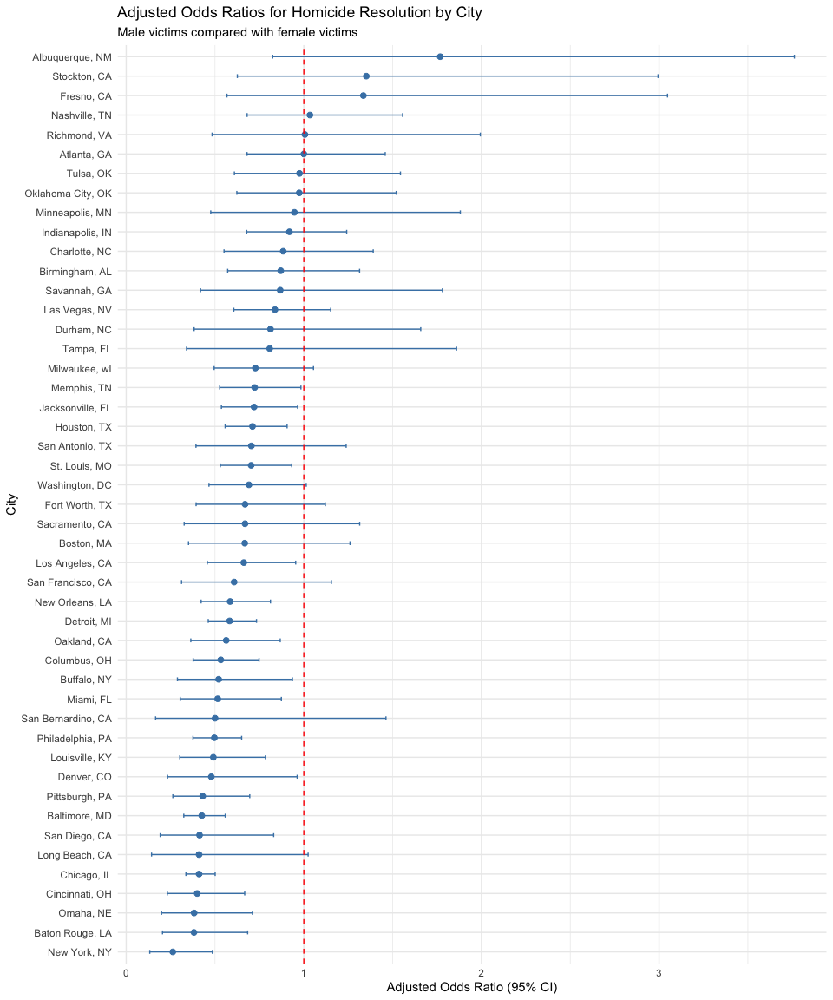

p8105_hw6_tc3609
================
Joanna Chuang
2026-11-23

# Problem 1

``` r
library(tidyverse)
library(broom)
```

``` r
homicide_df =
  read_csv(
    "https://raw.githubusercontent.com/washingtonpost/data-homicides/master/homicide-data.csv",
    na = c("", "Unknown"),
    show_col_types = FALSE
  ) |>
  mutate(
    city_state = str_c(city, state, sep = ", "),
    resolved = if_else(disposition == "Closed by arrest", 1, 0),
    victim_age = as.numeric(victim_age)
  ) |>
  filter(
    !city_state %in% c(
      "Dallas, TX",
      "Phoenix, AZ",
      "Kansas City, MO",
      "Tulsa, AL"
    ),
    victim_race %in% c("White", "Black")
  ) |>
  mutate(
    victim_sex = factor(victim_sex, levels = c("Female", "Male")),
    victim_race = factor(victim_race, levels = c("White", "Black"))
  )

homicide_df
```

    ## # A tibble: 39,693 × 14
    ##    uid        reported_date victim_last  victim_first victim_race victim_age
    ##    <chr>              <dbl> <chr>        <chr>        <fct>            <dbl>
    ##  1 Alb-000003      20100601 SATTERFIELD  VIVIANA      White               15
    ##  2 Alb-000005      20100102 MULA         VIVIAN       White               72
    ##  3 Alb-000006      20100126 BOOK         GERALDINE    White               91
    ##  4 Alb-000009      20100130 MARTIN-LEYVA GUSTAVO      White               56
    ##  5 Alb-000012      20100218 LUJAN        KEVIN        White               NA
    ##  6 Alb-000016      20100308 GRAY         STEFANIA     White               43
    ##  7 Alb-000018      20100323 DAVID        LARRY        White               52
    ##  8 Alb-000019      20100402 BRITO        ELIZABETH    White               22
    ##  9 Alb-000021      20100423 KING         TEVION       Black               15
    ## 10 Alb-000022      20100423 BOYKIN       CEDRIC       Black               25
    ## # ℹ 39,683 more rows
    ## # ℹ 8 more variables: victim_sex <fct>, city <chr>, state <chr>, lat <dbl>,
    ## #   lon <dbl>, disposition <chr>, city_state <chr>, resolved <dbl>

``` r
baltimore_df =
  homicide_df |>
  filter(city_state == "Baltimore, MD")

baltimore_fit =
  glm(
    resolved ~ victim_age + victim_sex + victim_race,
    data = baltimore_df,
    family = binomial()
  )

baltimore_fit
```

    ## 
    ## Call:  glm(formula = resolved ~ victim_age + victim_sex + victim_race, 
    ##     family = binomial(), data = baltimore_df)
    ## 
    ## Coefficients:
    ##      (Intercept)        victim_age    victim_sexMale  victim_raceBlack  
    ##         1.151737         -0.006727         -0.854463         -0.841756  
    ## 
    ## Degrees of Freedom: 2752 Total (i.e. Null);  2749 Residual
    ## Null Deviance:       3568 
    ## Residual Deviance: 3493  AIC: 3501

``` r
baltimore_results =
  baltimore_fit |>
  broom::tidy(
    conf.int = TRUE,
    exponentiate = TRUE
  ) |>
  filter(term == "victim_sexMale") |>
  select(term, estimate, conf.low, conf.high)

baltimore_results |>
  knitr::kable(digits = 4)
```

| term           | estimate | conf.low | conf.high |
|:---------------|---------:|---------:|----------:|
| victim_sexMale |   0.4255 |   0.3242 |    0.5576 |

``` r
city_results =
  homicide_df |>
  group_by(city_state) |>
  nest() |>
  mutate(
    model = map(
      data,
      ~ glm(
        resolved ~ victim_age + victim_sex + victim_race,
        data = .x,
        family = binomial()
      )
    ),
    results = map(
      model,
      ~ broom::tidy(
        .x,
        conf.int = TRUE,
        exponentiate = TRUE
      )
    )
  ) |>
  select(city_state, results) |>
  unnest(results) |>
  filter(term == "victim_sexMale") |>
  select(city_state, estimate, conf.low, conf.high) |>
  ungroup()

city_results |>
  knitr::kable(digits = 4)
```

| city_state         | estimate | conf.low | conf.high |
|:-------------------|---------:|---------:|----------:|
| Albuquerque, NM    |   1.7675 |   0.8247 |    3.7619 |
| Atlanta, GA        |   1.0001 |   0.6803 |    1.4583 |
| Baltimore, MD      |   0.4255 |   0.3242 |    0.5576 |
| Baton Rouge, LA    |   0.3814 |   0.2043 |    0.6836 |
| Birmingham, AL     |   0.8700 |   0.5714 |    1.3138 |
| Boston, MA         |   0.6673 |   0.3508 |    1.2600 |
| Buffalo, NY        |   0.5206 |   0.2884 |    0.9358 |
| Charlotte, NC      |   0.8839 |   0.5507 |    1.3906 |
| Chicago, IL        |   0.4101 |   0.3361 |    0.5009 |
| Cincinnati, OH     |   0.3998 |   0.2314 |    0.6670 |
| Columbus, OH       |   0.5325 |   0.3770 |    0.7479 |
| Denver, CO         |   0.4791 |   0.2327 |    0.9625 |
| Detroit, MI        |   0.5823 |   0.4619 |    0.7335 |
| Durham, NC         |   0.8124 |   0.3824 |    1.6580 |
| Fort Worth, TX     |   0.6690 |   0.3935 |    1.1212 |
| Fresno, CA         |   1.3352 |   0.5673 |    3.0475 |
| Houston, TX        |   0.7110 |   0.5570 |    0.9057 |
| Indianapolis, IN   |   0.9187 |   0.6785 |    1.2413 |
| Jacksonville, FL   |   0.7198 |   0.5359 |    0.9651 |
| Las Vegas, NV      |   0.8373 |   0.6059 |    1.1511 |
| Long Beach, CA     |   0.4102 |   0.1427 |    1.0242 |
| Los Angeles, CA    |   0.6619 |   0.4565 |    0.9541 |
| Louisville, KY     |   0.4906 |   0.3015 |    0.7836 |
| Memphis, TN        |   0.7232 |   0.5261 |    0.9836 |
| Miami, FL          |   0.5152 |   0.3040 |    0.8734 |
| Milwaukee, wI      |   0.7271 |   0.4951 |    1.0542 |
| Minneapolis, MN    |   0.9470 |   0.4759 |    1.8810 |
| Nashville, TN      |   1.0342 |   0.6807 |    1.5560 |
| New Orleans, LA    |   0.5849 |   0.4219 |    0.8122 |
| New York, NY       |   0.2624 |   0.1328 |    0.4850 |
| Oakland, CA        |   0.5631 |   0.3637 |    0.8671 |
| Oklahoma City, OK  |   0.9741 |   0.6229 |    1.5200 |
| Omaha, NE          |   0.3825 |   0.1988 |    0.7109 |
| Philadelphia, PA   |   0.4963 |   0.3760 |    0.6499 |
| Pittsburgh, PA     |   0.4308 |   0.2626 |    0.6956 |
| Richmond, VA       |   1.0061 |   0.4835 |    1.9936 |
| San Antonio, TX    |   0.7046 |   0.3928 |    1.2383 |
| Sacramento, CA     |   0.6688 |   0.3263 |    1.3144 |
| Savannah, GA       |   0.8670 |   0.4186 |    1.7802 |
| San Bernardino, CA |   0.5003 |   0.1655 |    1.4624 |
| San Diego, CA      |   0.4130 |   0.1914 |    0.8302 |
| San Francisco, CA  |   0.6075 |   0.3117 |    1.1551 |
| St. Louis, MO      |   0.7032 |   0.5299 |    0.9319 |
| Stockton, CA       |   1.3517 |   0.6256 |    2.9941 |
| Tampa, FL          |   0.8077 |   0.3395 |    1.8599 |
| Tulsa, OK          |   0.9758 |   0.6091 |    1.5439 |
| Washington, DC     |   0.6910 |   0.4660 |    1.0135 |

``` r
city_results |>
  mutate(
    city_state = fct_reorder(city_state, estimate)
  ) |>
  ggplot(aes(x = city_state, y = estimate)) +
  geom_point(color = "steelblue", size = 2) +
  geom_errorbar(
    aes(ymin = conf.low, ymax = conf.high),
    width = 0.2,
    color = "steelblue"
  ) +
  geom_hline(
    yintercept = 1,
    linetype = "dashed",
    color = "red"
  ) +
  coord_flip() +
  labs(
    title = "Adjusted Odds Ratios for Homicide Resolution by City",
    subtitle = "Male victims compared with female victims",
    x = "City",
    y = "Adjusted Odds Ratio (95% CI)"
  ) +
  theme_minimal()
```

<!-- --> Most
cities had odds ratios below 1, meaning that homicides involving male
victims generally had lower odds of being solved than those involving
female victims after adjusting for age and race. However, several cities
had confidence intervals that included 1, so the difference was not
statistically significant in those cities. Some cities also had wider
confidence intervals, suggesting that their estimates were less precise.
