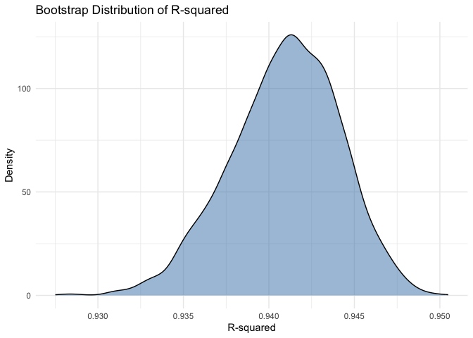
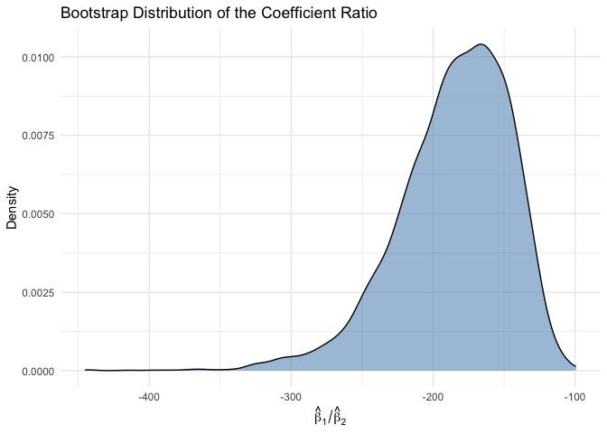
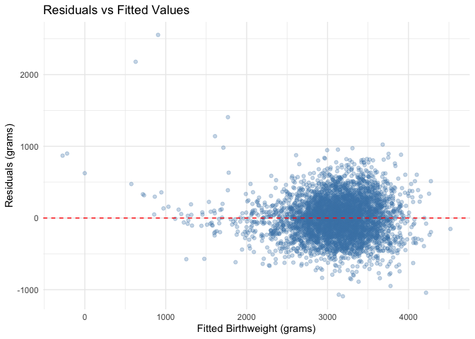
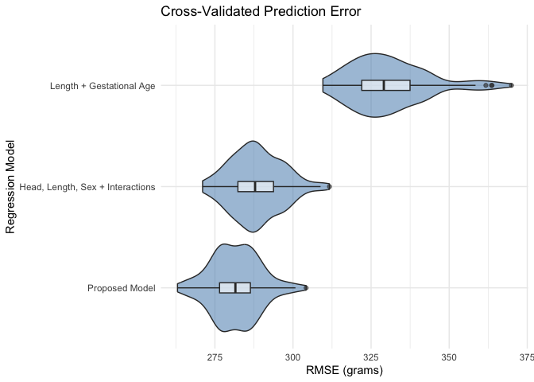

p8105_hw6_tc3609
================
Joanna Chuang
2026-11-23

# Problem 1

``` r
library(tidyverse)
library(broom)
```

``` r
homicide_df =
  read_csv(
    "https://raw.githubusercontent.com/washingtonpost/data-homicides/master/homicide-data.csv",
    na = c("", "Unknown"),
    show_col_types = FALSE
  ) |>
  mutate(
    city_state = str_c(city, state, sep = ", "),
    resolved = if_else(disposition == "Closed by arrest", 1, 0),
    victim_age = as.numeric(victim_age)
  ) |>
  filter(
    !city_state %in% c(
      "Dallas, TX",
      "Phoenix, AZ",
      "Kansas City, MO",
      "Tulsa, AL"
    ),
    victim_race %in% c("White", "Black")
  ) |>
  mutate(
    victim_sex = factor(victim_sex, levels = c("Female", "Male")),
    victim_race = factor(victim_race, levels = c("White", "Black"))
  )

homicide_df
```

    ## # A tibble: 39,693 × 14
    ##    uid        reported_date victim_last  victim_first victim_race victim_age
    ##    <chr>              <dbl> <chr>        <chr>        <fct>            <dbl>
    ##  1 Alb-000003      20100601 SATTERFIELD  VIVIANA      White               15
    ##  2 Alb-000005      20100102 MULA         VIVIAN       White               72
    ##  3 Alb-000006      20100126 BOOK         GERALDINE    White               91
    ##  4 Alb-000009      20100130 MARTIN-LEYVA GUSTAVO      White               56
    ##  5 Alb-000012      20100218 LUJAN        KEVIN        White               NA
    ##  6 Alb-000016      20100308 GRAY         STEFANIA     White               43
    ##  7 Alb-000018      20100323 DAVID        LARRY        White               52
    ##  8 Alb-000019      20100402 BRITO        ELIZABETH    White               22
    ##  9 Alb-000021      20100423 KING         TEVION       Black               15
    ## 10 Alb-000022      20100423 BOYKIN       CEDRIC       Black               25
    ## # ℹ 39,683 more rows
    ## # ℹ 8 more variables: victim_sex <fct>, city <chr>, state <chr>, lat <dbl>,
    ## #   lon <dbl>, disposition <chr>, city_state <chr>, resolved <dbl>

``` r
baltimore_df =
  homicide_df |>
  filter(city_state == "Baltimore, MD")

baltimore_fit =
  glm(
    resolved ~ victim_age + victim_sex + victim_race,
    data = baltimore_df,
    family = binomial()
  )

baltimore_fit
```

    ## 
    ## Call:  glm(formula = resolved ~ victim_age + victim_sex + victim_race, 
    ##     family = binomial(), data = baltimore_df)
    ## 
    ## Coefficients:
    ##      (Intercept)        victim_age    victim_sexMale  victim_raceBlack  
    ##         1.151737         -0.006727         -0.854463         -0.841756  
    ## 
    ## Degrees of Freedom: 2752 Total (i.e. Null);  2749 Residual
    ## Null Deviance:       3568 
    ## Residual Deviance: 3493  AIC: 3501

``` r
baltimore_results =
  baltimore_fit |>
  broom::tidy(
    conf.int = TRUE,
    exponentiate = TRUE
  ) |>
  filter(term == "victim_sexMale") |>
  select(term, estimate, conf.low, conf.high)

baltimore_results |>
  knitr::kable(digits = 4)
```

| term           | estimate | conf.low | conf.high |
|:---------------|---------:|---------:|----------:|
| victim_sexMale |   0.4255 |   0.3242 |    0.5576 |

``` r
city_results =
  homicide_df |>
  group_by(city_state) |>
  nest() |>
  mutate(
    model = map(
      data,
      ~ glm(
        resolved ~ victim_age + victim_sex + victim_race,
        data = .x,
        family = binomial()
      )
    ),
    results = map(
      model,
      ~ broom::tidy(
        .x,
        conf.int = TRUE,
        exponentiate = TRUE
      )
    )
  ) |>
  select(city_state, results) |>
  unnest(results) |>
  filter(term == "victim_sexMale") |>
  select(city_state, estimate, conf.low, conf.high) |>
  ungroup()

city_results |>
  knitr::kable(digits = 4)
```

| city_state         | estimate | conf.low | conf.high |
|:-------------------|---------:|---------:|----------:|
| Albuquerque, NM    |   1.7675 |   0.8247 |    3.7619 |
| Atlanta, GA        |   1.0001 |   0.6803 |    1.4583 |
| Baltimore, MD      |   0.4255 |   0.3242 |    0.5576 |
| Baton Rouge, LA    |   0.3814 |   0.2043 |    0.6836 |
| Birmingham, AL     |   0.8700 |   0.5714 |    1.3138 |
| Boston, MA         |   0.6673 |   0.3508 |    1.2600 |
| Buffalo, NY        |   0.5206 |   0.2884 |    0.9358 |
| Charlotte, NC      |   0.8839 |   0.5507 |    1.3906 |
| Chicago, IL        |   0.4101 |   0.3361 |    0.5009 |
| Cincinnati, OH     |   0.3998 |   0.2314 |    0.6670 |
| Columbus, OH       |   0.5325 |   0.3770 |    0.7479 |
| Denver, CO         |   0.4791 |   0.2327 |    0.9625 |
| Detroit, MI        |   0.5823 |   0.4619 |    0.7335 |
| Durham, NC         |   0.8124 |   0.3824 |    1.6580 |
| Fort Worth, TX     |   0.6690 |   0.3935 |    1.1212 |
| Fresno, CA         |   1.3352 |   0.5673 |    3.0475 |
| Houston, TX        |   0.7110 |   0.5570 |    0.9057 |
| Indianapolis, IN   |   0.9187 |   0.6785 |    1.2413 |
| Jacksonville, FL   |   0.7198 |   0.5359 |    0.9651 |
| Las Vegas, NV      |   0.8373 |   0.6059 |    1.1511 |
| Long Beach, CA     |   0.4102 |   0.1427 |    1.0242 |
| Los Angeles, CA    |   0.6619 |   0.4565 |    0.9541 |
| Louisville, KY     |   0.4906 |   0.3015 |    0.7836 |
| Memphis, TN        |   0.7232 |   0.5261 |    0.9836 |
| Miami, FL          |   0.5152 |   0.3040 |    0.8734 |
| Milwaukee, wI      |   0.7271 |   0.4951 |    1.0542 |
| Minneapolis, MN    |   0.9470 |   0.4759 |    1.8810 |
| Nashville, TN      |   1.0342 |   0.6807 |    1.5560 |
| New Orleans, LA    |   0.5849 |   0.4219 |    0.8122 |
| New York, NY       |   0.2624 |   0.1328 |    0.4850 |
| Oakland, CA        |   0.5631 |   0.3637 |    0.8671 |
| Oklahoma City, OK  |   0.9741 |   0.6229 |    1.5200 |
| Omaha, NE          |   0.3825 |   0.1988 |    0.7109 |
| Philadelphia, PA   |   0.4963 |   0.3760 |    0.6499 |
| Pittsburgh, PA     |   0.4308 |   0.2626 |    0.6956 |
| Richmond, VA       |   1.0061 |   0.4835 |    1.9936 |
| San Antonio, TX    |   0.7046 |   0.3928 |    1.2383 |
| Sacramento, CA     |   0.6688 |   0.3263 |    1.3144 |
| Savannah, GA       |   0.8670 |   0.4186 |    1.7802 |
| San Bernardino, CA |   0.5003 |   0.1655 |    1.4624 |
| San Diego, CA      |   0.4130 |   0.1914 |    0.8302 |
| San Francisco, CA  |   0.6075 |   0.3117 |    1.1551 |
| St. Louis, MO      |   0.7032 |   0.5299 |    0.9319 |
| Stockton, CA       |   1.3517 |   0.6256 |    2.9941 |
| Tampa, FL          |   0.8077 |   0.3395 |    1.8599 |
| Tulsa, OK          |   0.9758 |   0.6091 |    1.5439 |
| Washington, DC     |   0.6910 |   0.4660 |    1.0135 |

``` r
city_results |>
  mutate(
    city_state = fct_reorder(city_state, estimate)
  ) |>
  ggplot(aes(x = city_state, y = estimate)) +
  geom_point(color = "steelblue", size = 2) +
  geom_errorbar(
    aes(ymin = conf.low, ymax = conf.high),
    width = 0.2,
    color = "steelblue"
  ) +
  geom_hline(
    yintercept = 1,
    linetype = "dashed",
    color = "red"
  ) +
  coord_flip() +
  labs(
    title = "Adjusted Odds Ratios for Homicide Resolution by City",
    subtitle = "Male victims compared with female victims",
    x = "City",
    y = "Adjusted Odds Ratio (95% CI)"
  ) +
  theme_minimal()
```

<!-- --> Most
cities had odds ratios below 1, meaning that homicides involving male
victims generally had lower odds of being solved than those involving
female victims after adjusting for age and race. However, several cities
had confidence intervals that included 1, so the difference was not
statistically significant in those cities. Some cities also had wider
confidence intervals, suggesting that their estimates were less precise.

# Problem 2

``` r
library(p8105.datasets)
data("weather_df")

weather_df =
  weather_df |>
  select(tmax, tmin, prcp) |>
  drop_na()

weather_df
```

    ## # A tibble: 2,171 × 3
    ##     tmax  tmin  prcp
    ##    <dbl> <dbl> <dbl>
    ##  1   4.4   0.6   157
    ##  2  10.6   2.2    13
    ##  3   3.3   1.1    56
    ##  4   6.1   1.7     5
    ##  5   5.6   2.2     0
    ##  6   5     1.1     0
    ##  7   5    -1       0
    ##  8   2.8  -2.7     0
    ##  9   2.8  -4.3     0
    ## 10   5    -1.6     0
    ## # ℹ 2,161 more rows

``` r
boot_sample = function(df) {
  sample_frac(df, size = 1, replace = TRUE)
}
```

``` r
set.seed(123)

boot_results =
  tibble(
    replicate = 1:5000
  ) |>
  mutate(
    boot_sample = map(
      replicate, ~ boot_sample(weather_df)
    ),
    model = map(
      boot_sample,
      ~ lm(tmax ~ tmin + prcp, data = .x)
    ),
    glance_results = map(model, broom::glance),
    tidy_results = map(model, broom::tidy)
  )

boot_results
```

    ## # A tibble: 5,000 × 5
    ##    replicate boot_sample          model  glance_results    tidy_results    
    ##        <int> <list>               <list> <list>            <list>          
    ##  1         1 <tibble [2,171 × 3]> <lm>   <tibble [1 × 12]> <tibble [3 × 5]>
    ##  2         2 <tibble [2,171 × 3]> <lm>   <tibble [1 × 12]> <tibble [3 × 5]>
    ##  3         3 <tibble [2,171 × 3]> <lm>   <tibble [1 × 12]> <tibble [3 × 5]>
    ##  4         4 <tibble [2,171 × 3]> <lm>   <tibble [1 × 12]> <tibble [3 × 5]>
    ##  5         5 <tibble [2,171 × 3]> <lm>   <tibble [1 × 12]> <tibble [3 × 5]>
    ##  6         6 <tibble [2,171 × 3]> <lm>   <tibble [1 × 12]> <tibble [3 × 5]>
    ##  7         7 <tibble [2,171 × 3]> <lm>   <tibble [1 × 12]> <tibble [3 × 5]>
    ##  8         8 <tibble [2,171 × 3]> <lm>   <tibble [1 × 12]> <tibble [3 × 5]>
    ##  9         9 <tibble [2,171 × 3]> <lm>   <tibble [1 × 12]> <tibble [3 × 5]>
    ## 10        10 <tibble [2,171 × 3]> <lm>   <tibble [1 × 12]> <tibble [3 × 5]>
    ## # ℹ 4,990 more rows

``` r
r_squared_results =
  boot_results |>
  select(replicate, glance_results) |>
  unnest(glance_results) |>
  select(replicate, r.squared)

r_squared_results
```

    ## # A tibble: 5,000 × 2
    ##    replicate r.squared
    ##        <int>     <dbl>
    ##  1         1     0.936
    ##  2         2     0.939
    ##  3         3     0.943
    ##  4         4     0.946
    ##  5         5     0.941
    ##  6         6     0.941
    ##  7         7     0.942
    ##  8         8     0.940
    ##  9         9     0.940
    ## 10        10     0.939
    ## # ℹ 4,990 more rows

``` r
beta_results =
  boot_results |>
  select(replicate, tidy_results) |>
  unnest(tidy_results) |>
  filter(term %in% c("tmin", "prcp")) |>
  select(replicate, term, estimate) |>
  pivot_wider(
    names_from = term,
    values_from = estimate
  ) |>
  mutate(
    beta_ratio = tmin / prcp
  ) |>
  select(replicate, beta_ratio)

beta_results
```

    ## # A tibble: 5,000 × 2
    ##    replicate beta_ratio
    ##        <int>      <dbl>
    ##  1         1      -158.
    ##  2         2      -217.
    ##  3         3      -159.
    ##  4         4      -196.
    ##  5         5      -142.
    ##  6         6      -142.
    ##  7         7      -122.
    ##  8         8      -140.
    ##  9         9      -194.
    ## 10        10      -212.
    ## # ℹ 4,990 more rows

``` r
bootstrap_estimates =
  left_join(
    r_squared_results,
    beta_results,
    by = "replicate"
  )

bootstrap_estimates
```

    ## # A tibble: 5,000 × 3
    ##    replicate r.squared beta_ratio
    ##        <int>     <dbl>      <dbl>
    ##  1         1     0.936      -158.
    ##  2         2     0.939      -217.
    ##  3         3     0.943      -159.
    ##  4         4     0.946      -196.
    ##  5         5     0.941      -142.
    ##  6         6     0.941      -142.
    ##  7         7     0.942      -122.
    ##  8         8     0.940      -140.
    ##  9         9     0.940      -194.
    ## 10        10     0.939      -212.
    ## # ℹ 4,990 more rows

``` r
bootstrap_estimates |>
  ggplot(aes(x = r.squared)) +
  geom_density(
    fill = "steelblue",
    alpha = 0.5
  ) +
  labs(
    title = "Bootstrap Distribution of R-squared",
    x = "R-squared",
    y = "Density"
  ) +
  theme_minimal()
```

<!-- -->
The bootstrap distribution of R-squared is roughly bell-shaped with a
slight left skew and is centered around 0.941. The estimates are
concentrated within a narrow range, suggesting that R-squared remains
mostly consistent across bootstrap samples. The 95% bootstrap confidence
interval is (0.9344, 0.9466).

``` r
bootstrap_estimates |>
  ggplot(aes(x = beta_ratio)) +
  geom_density(
    fill = "steelblue",
    alpha = 0.5
  ) +
  labs(
    title = "Bootstrap Distribution of the Coefficient Ratio",
    x = expression(hat(beta)[1] / hat(beta)[2]),
    y = "Density"
  ) +
  theme_minimal()
```

<!-- -->

The bootstrap distribution of the coefficient ratio is left-skewed, with
a longer tail toward more negative values. The mean estimate is
−185.4894, and the 95% bootstrap confidence interval is (−277.1703,
−125.7063).

``` r
bootstrap_ci =
  bootstrap_estimates |>
  pivot_longer(
    cols = c(r.squared, beta_ratio),
    names_to = "statistic",
    values_to = "estimate"
  ) |>
  group_by(statistic) |>
  summarize(
    mean_estimate = mean(estimate),
    conf.low = quantile(estimate, 0.025),
    conf.high = quantile(estimate, 0.975),
    .groups = "drop"
  )

bootstrap_ci |>
  knitr::kable(digits = 4)
```

| statistic  | mean_estimate |  conf.low | conf.high |
|:-----------|--------------:|----------:|----------:|
| beta_ratio |     -185.4894 | -277.1703 | -125.7063 |
| r.squared  |        0.9409 |    0.9344 |    0.9466 |

# Problem 3

``` r
library(modelr)
library(janitor)

birthweight_df =
  read_csv("data/birthweight.csv", show_col_types = FALSE) |>
  janitor::clean_names() |>
  mutate(
    babysex = factor(
      babysex,
      levels = c(1, 2),
      labels = c("Male", "Female")
    ),
    frace = factor(
      frace,
      levels = c(1, 2, 3, 4, 8, 9),
      labels = c("White", "Black", "Asian",
                 "Puerto Rican", "Other", "Unknown")
    ),
    mrace = factor(
      mrace,
      levels = c(1, 2, 3, 4, 8),
      labels = c("White", "Black", "Asian",
                 "Puerto Rican", "Other")
    ),
    malform = factor(
      malform,
      levels = c(0, 1),
      labels = c("Absent", "Present")
    )
  )

birthweight_df
```

    ## # A tibble: 4,342 × 20
    ##    babysex bhead blength   bwt delwt fincome frace gaweeks malform menarche
    ##    <fct>   <dbl>   <dbl> <dbl> <dbl>   <dbl> <fct>   <dbl> <fct>      <dbl>
    ##  1 Female     34      51  3629   177      35 White    39.9 Absent        13
    ##  2 Male       34      48  3062   156      65 Black    25.9 Absent        14
    ##  3 Female     36      50  3345   148      85 White    39.9 Absent        12
    ##  4 Male       34      52  3062   157      55 White    40   Absent        14
    ##  5 Female     34      52  3374   156       5 White    41.6 Absent        13
    ##  6 Male       33      52  3374   129      55 White    40.7 Absent        12
    ##  7 Female     33      46  2523   126      96 Black    40.3 Absent        14
    ##  8 Female     33      49  2778   140       5 White    37.4 Absent        12
    ##  9 Male       36      52  3515   146      85 White    40.3 Absent        11
    ## 10 Male       33      50  3459   169      75 Black    40.7 Absent        12
    ## # ℹ 4,332 more rows
    ## # ℹ 10 more variables: mheight <dbl>, momage <dbl>, mrace <fct>, parity <dbl>,
    ## #   pnumlbw <dbl>, pnumsga <dbl>, ppbmi <dbl>, ppwt <dbl>, smoken <dbl>,
    ## #   wtgain <dbl>

``` r
birthweight_df |>
  summarize(
    across(everything(), ~ sum(is.na(.x)))
  ) |>
  pivot_longer(
    everything(),
    names_to = "variable",
    values_to = "missing"
  ) |>
  knitr::kable()
```

| variable | missing |
|:---------|--------:|
| babysex  |       0 |
| bhead    |       0 |
| blength  |       0 |
| bwt      |       0 |
| delwt    |       0 |
| fincome  |       0 |
| frace    |       0 |
| gaweeks  |       0 |
| malform  |       0 |
| menarche |       0 |
| mheight  |       0 |
| momage   |       0 |
| mrace    |       0 |
| parity   |       0 |
| pnumlbw  |       0 |
| pnumsga  |       0 |
| ppbmi    |       0 |
| ppwt     |       0 |
| smoken   |       0 |
| wtgain   |       0 |

``` r
my_model =
  lm(
    bwt ~ bhead + blength + gaweeks + babysex +
      smoken + ppbmi + wtgain + momage,
    data = birthweight_df
  )

my_model |>
  broom::tidy() |>
  knitr::kable(digits = 4)
```

| term          |   estimate | std.error | statistic | p.value |
|:--------------|-----------:|----------:|----------:|--------:|
| (Intercept)   | -6261.4569 |   99.6665 |  -62.8241 |   0e+00 |
| bhead         |   136.2383 |    3.5327 |   38.5644 |   0e+00 |
| blength       |    79.3339 |    2.0609 |   38.4945 |   0e+00 |
| gaweeks       |    12.6918 |    1.5021 |    8.4494 |   0e+00 |
| babysexFemale |    33.8156 |    8.7124 |    3.8813 |   1e-04 |
| smoken        |    -2.3033 |    0.5819 |   -3.9586 |   1e-04 |
| ppbmi         |     4.6158 |    1.3611 |    3.3911 |   7e-04 |
| wtgain        |     4.0230 |    0.4062 |    9.9051 |   0e+00 |
| momage        |     7.3269 |    1.1246 |    6.5149 |   0e+00 |

``` r
my_model |>
  broom::glance() |>
  select(r.squared, adj.r.squared, sigma) |>
  knitr::kable(digits = 4)
```

| r.squared | adj.r.squared |    sigma |
|----------:|--------------:|---------:|
|    0.6991 |        0.6985 | 281.2125 |

I selected variables based on their potential relationship with
birthweight. Head circumference, birth length, gestational age, and baby
sex were included to account for differences in fetal growth. I also
included maternal smoking, pre-pregnancy BMI, weight gain during
pregnancy, and maternal age because these factors may be related to
birthweight. I avoided including maternal weight variables that were
closely related to each other to reduce multicollinearity. The model
explained approximately 69.9% of the variation in birthweight.

``` r
birthweight_df |>
  add_predictions(my_model) |>
  add_residuals(my_model) |>
  ggplot(aes(x = pred, y = resid)) +
  geom_point(alpha = 0.3, color = "steelblue") +
  geom_hline(
    yintercept = 0,
    color = "red",
    linetype = "dashed"
  ) +
  labs(
    title = "Residuals vs Fitted Values",
    x = "Fitted Birthweight (grams)",
    y = "Residuals (grams)"
  ) +
  theme_minimal()
```

<!-- -->

``` r
model_1 =
  lm(
    bwt ~ blength + gaweeks,
    data = birthweight_df
  )
```

``` r
model_2 =
  lm(
    bwt ~ bhead * blength * babysex,
    data = birthweight_df
  )
```

``` r
set.seed(123)

cv_df =
  crossv_mc(
    birthweight_df,
    n = 100,
    test = 0.2
  ) |>
  mutate(
    train = map(train, as_tibble),
    test = map(test, as_tibble)
  )

cv_df
```

    ## # A tibble: 100 × 3
    ##    train                 test                .id  
    ##    <list>                <list>              <chr>
    ##  1 <tibble [3,473 × 20]> <tibble [869 × 20]> 001  
    ##  2 <tibble [3,473 × 20]> <tibble [869 × 20]> 002  
    ##  3 <tibble [3,473 × 20]> <tibble [869 × 20]> 003  
    ##  4 <tibble [3,473 × 20]> <tibble [869 × 20]> 004  
    ##  5 <tibble [3,473 × 20]> <tibble [869 × 20]> 005  
    ##  6 <tibble [3,473 × 20]> <tibble [869 × 20]> 006  
    ##  7 <tibble [3,473 × 20]> <tibble [869 × 20]> 007  
    ##  8 <tibble [3,473 × 20]> <tibble [869 × 20]> 008  
    ##  9 <tibble [3,473 × 20]> <tibble [869 × 20]> 009  
    ## 10 <tibble [3,473 × 20]> <tibble [869 × 20]> 010  
    ## # ℹ 90 more rows

``` r
cv_results =
  cv_df |>
  mutate(
    my_model = map(
      train,
      ~ lm(
        bwt ~ bhead + blength + gaweeks + babysex +
          smoken + ppbmi + wtgain + momage,
        data = .x
      )
    ),
    model_1 = map(
      train,
      ~ lm(bwt ~ blength + gaweeks, data = .x)
    ),
    model_2 = map(
      train,
      ~ lm(bwt ~ bhead * blength * babysex, data = .x)
    )
  ) |>
  mutate(
    rmse_my_model = map2_dbl(my_model, test, rmse),
    rmse_model_1 = map2_dbl(model_1, test, rmse),
    rmse_model_2 = map2_dbl(model_2, test, rmse)
  )

cv_results
```

    ## # A tibble: 100 × 9
    ##    train    test     .id   my_model model_1 model_2 rmse_my_model rmse_model_1
    ##    <list>   <list>   <chr> <list>   <list>  <list>          <dbl>        <dbl>
    ##  1 <tibble> <tibble> 001   <lm>     <lm>    <lm>             281.         326.
    ##  2 <tibble> <tibble> 002   <lm>     <lm>    <lm>             288.         343.
    ##  3 <tibble> <tibble> 003   <lm>     <lm>    <lm>             276.         341.
    ##  4 <tibble> <tibble> 004   <lm>     <lm>    <lm>             286.         340.
    ##  5 <tibble> <tibble> 005   <lm>     <lm>    <lm>             291.         362.
    ##  6 <tibble> <tibble> 006   <lm>     <lm>    <lm>             285.         343.
    ##  7 <tibble> <tibble> 007   <lm>     <lm>    <lm>             276.         316.
    ##  8 <tibble> <tibble> 008   <lm>     <lm>    <lm>             279.         325.
    ##  9 <tibble> <tibble> 009   <lm>     <lm>    <lm>             275.         316.
    ## 10 <tibble> <tibble> 010   <lm>     <lm>    <lm>             286.         334.
    ## # ℹ 90 more rows
    ## # ℹ 1 more variable: rmse_model_2 <dbl>

``` r
cv_plot_df =
  cv_results |>
  select(starts_with("rmse_")) |>
  pivot_longer(
    everything(),
    names_to = "model",
    values_to = "rmse"
  ) |>
  mutate(
    model = recode(
      model,
      rmse_my_model = "Proposed Model",
      rmse_model_1 = "Length + Gestational Age",
      rmse_model_2 = "Head, Length, Sex + Interactions"
    )
  )

cv_plot_df
```

    ## # A tibble: 300 × 2
    ##    model                             rmse
    ##    <chr>                            <dbl>
    ##  1 Proposed Model                    281.
    ##  2 Length + Gestational Age          326.
    ##  3 Head, Length, Sex + Interactions  287.
    ##  4 Proposed Model                    288.
    ##  5 Length + Gestational Age          343.
    ##  6 Head, Length, Sex + Interactions  294.
    ##  7 Proposed Model                    276.
    ##  8 Length + Gestational Age          341.
    ##  9 Head, Length, Sex + Interactions  278.
    ## 10 Proposed Model                    286.
    ## # ℹ 290 more rows

``` r
cv_plot_df |>
  mutate(
    model = fct_reorder(model, rmse)
  ) |>
  ggplot(aes(x = model, y = rmse)) +
  geom_violin(
    fill = "steelblue",
    alpha = 0.5
  ) +
  geom_boxplot(
    width = 0.1,
    alpha = 0.6
  ) +
  coord_flip() +
  labs(
    title = "Cross-Validated Prediction Error",
    x = "Regression Model",
    y = "RMSE (grams)"
  ) +
  theme_minimal()
```

<!-- -->

The proposed model had the lowest mean RMSE of 281.68 grams, followed by
the interaction model at 288.38 grams. The model using only birth length
and gestational age had the highest mean RMSE of 330.71 grams. The
results suggest that including additional fetal and maternal
characteristics improves birthweight prediction.

``` r
cv_plot_df |>
  group_by(model) |>
  summarize(
    mean_rmse = mean(rmse),
    median_rmse = median(rmse),
    sd_rmse = sd(rmse),
    .groups = "drop"
  ) |>
  arrange(mean_rmse) |>
  knitr::kable(digits = 4)
```

| model                            | mean_rmse | median_rmse | sd_rmse |
|:---------------------------------|----------:|------------:|--------:|
| Proposed Model                   |  281.6793 |    281.5608 |  7.8549 |
| Head, Length, Sex + Interactions |  288.3849 |    287.8624 |  8.2441 |
| Length + Gestational Age         |  330.7093 |    329.0821 | 12.6334 |
